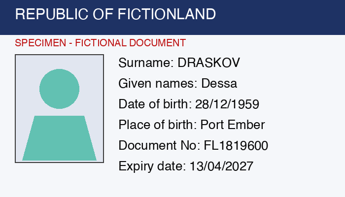

# doc-verification-ocr-llm

Standalone, simplified reimplementation of a document-verification pipeline (OCR + local LLM) I built for a public-sector back office. Uses fictional synthetic documents only and contains no code or data from the production system.

```
image -> OCR (Tesseract) -> structured JSON extraction (rules | local LLM)
      -> field-by-field comparison with declared data -> confidence score -> accept / review / reject
```

## Installation

```bash
brew install tesseract          # or apt install tesseract-ocr
python -m venv .venv && source .venv/bin/activate
pip install -r requirements.txt
# Optional: Ollama (https://ollama.com) with a local model, e.g. `ollama pull llama3.1`
```

## Usage

```bash
pytest -q
python examples/demo.py          # backend "rules" (default, no extra dependency)
python examples/demo.py ollama   # local LLM via Ollama HTTP API; falls back to rules if Ollama is unreachable
```

The demo generates 5 fictional cards, with declarations containing deliberate errors (typo, wrong date, wrong number), and writes `outputs/sample_card.png` and `outputs/results.json`.

- `rules`: regular expressions on OCR text.
- `ollama`: prompt enforcing JSON-only output, schema validation of the answer.

Scoring: names use fuzzy similarity (rapidfuzz); dates and document number use normalized equality. Weights and thresholds (accept >= 0.9, review >= 0.6) are configurable in `docverif/verify.py`.



## Limits and next steps

- Synthetic, clean images only; real scans need better preprocessing.
- Face comparison between the card photo and a selfie (`docverif/photo.py` only crops the photo area).
- Fraud and tampering detection.
- Verification against official registries.

## Author

Mickaël Agossa
